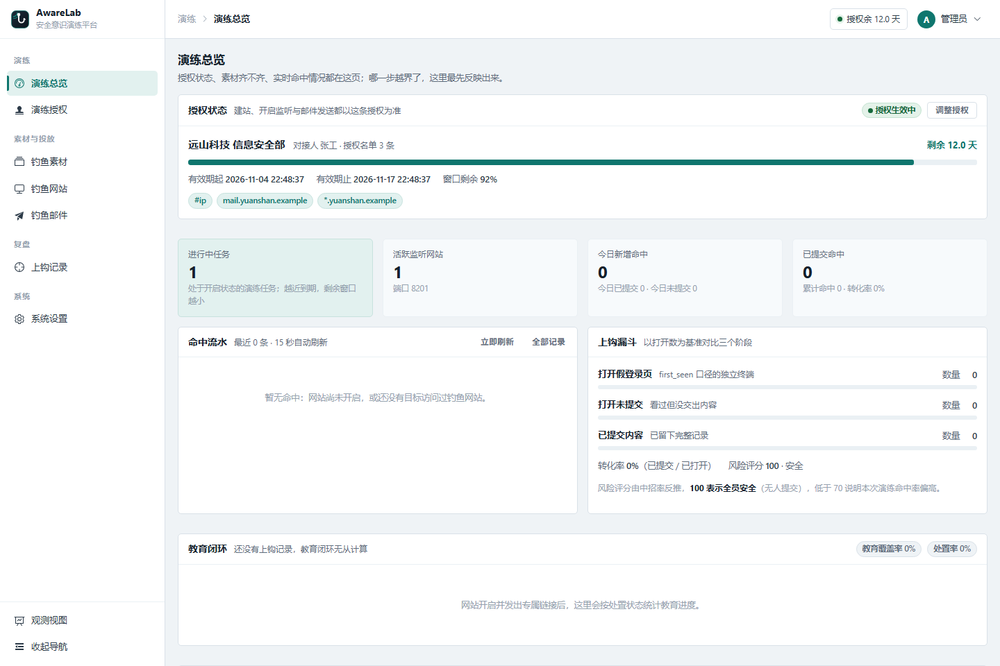
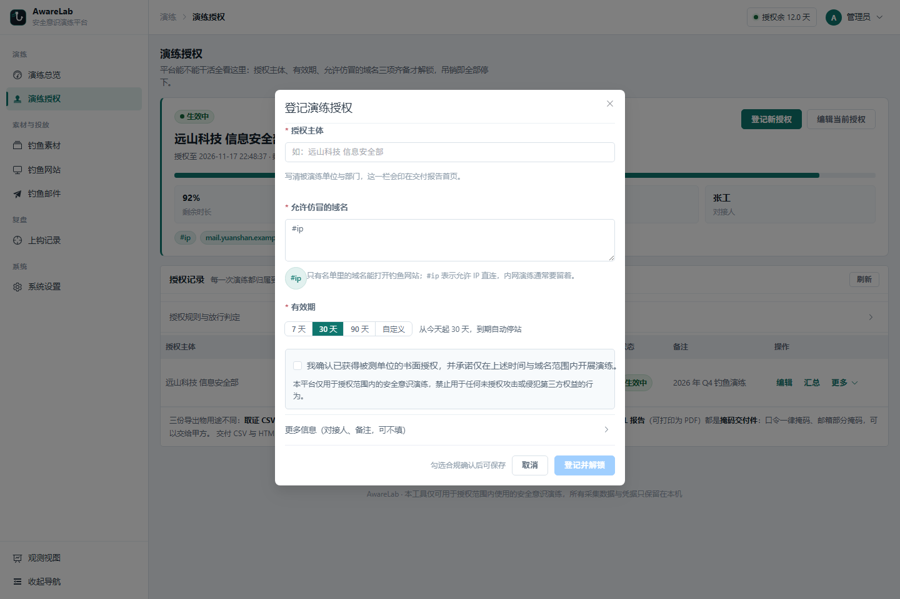
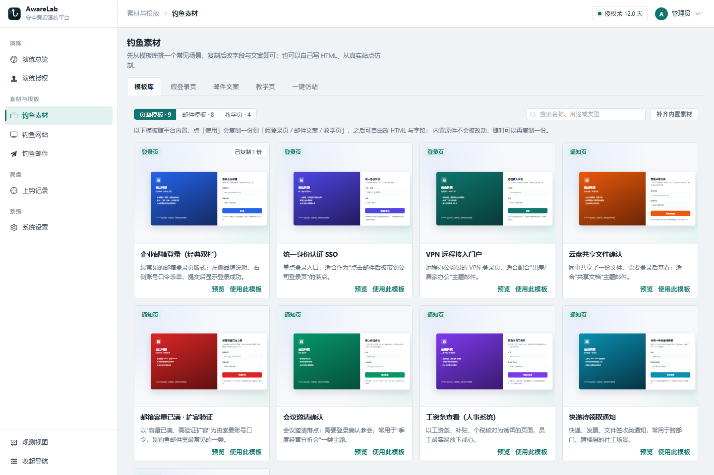
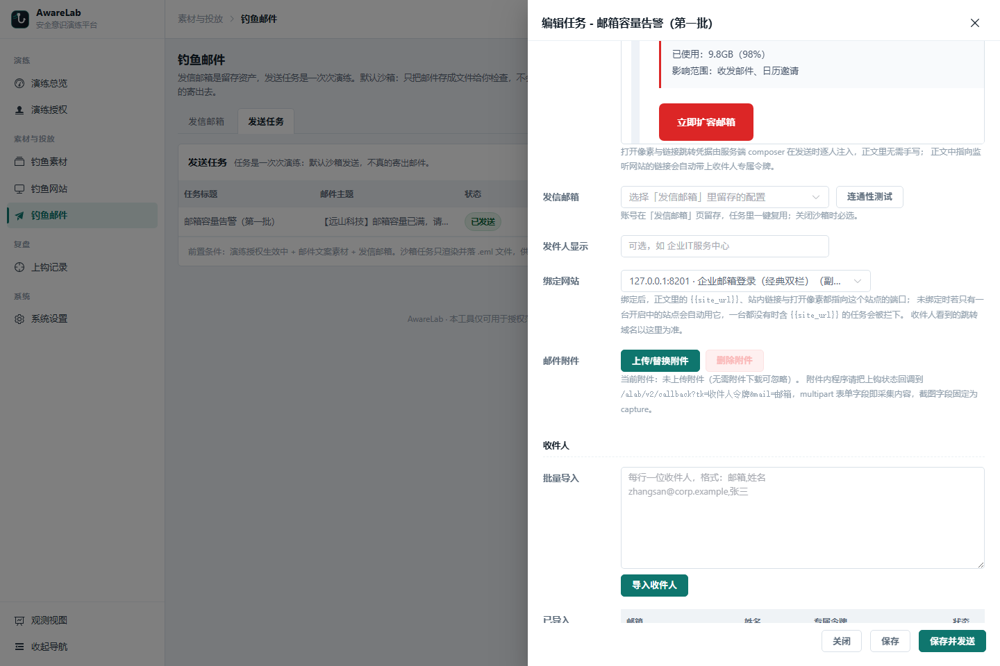
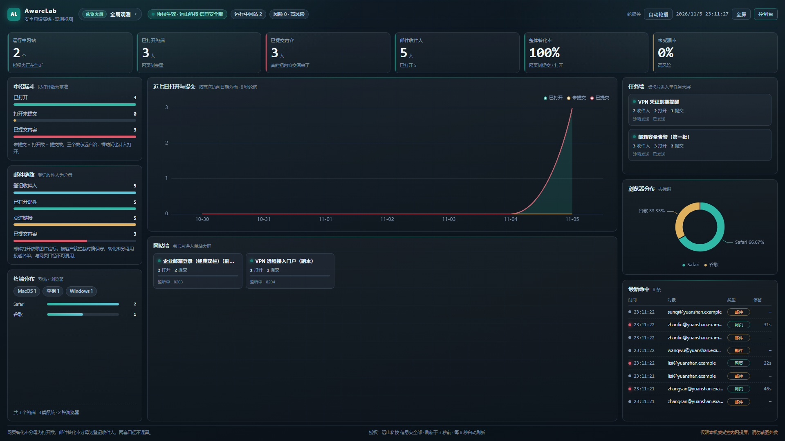
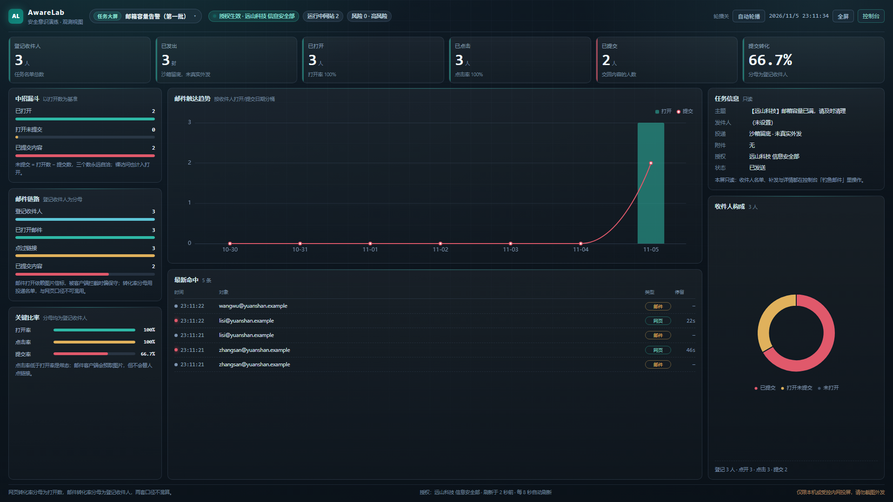

# AwareLab · 安全意识演练平台

<div align="center">
  
  <br />
  <a href="LICENSE"></a>
  
  
  
  
</div>

自研的钓鱼网页与钓鱼邮件演练平台，用 **Vue 3 + Node** 实现。红队与安全团队在拿到书面授权后，用它准备演练素材、挂起钓鱼网站、发送演练邮件，并把打开、提交、附件回传全过程记录成可交付的上钩记录。

> 本工具的危险性在于"能仿真钓鱼"。因此平台把**演练授权**做成硬约束：没有处于生效窗口的授权登记，建站监听与邮件发送一律拒绝；钓鱼网站只接受授权名单里的域名；邮件默认走沙箱，不会真的寄出去。

## 功能总览

| 能力 | 说明 |
| --- | --- |
| 演练授权 | 三步登记：授权主体、允许仿冒的域名、有效期（7 / 30 / 90 天或自定义），勾选一次合规承诺即可解锁；支持编辑续期，吊销或缩短有效期即刻停止下属网站监听 |
| 内置模板库 | 随包内置 9 套钓鱼页面（企业邮箱、SSO、VPN、共享文件、邮箱容量、会议邀请、工资条、快递、MFA）、8 套邮件文案与 4 套教学页；缩略图预览后一键复制到自己的素材，复制件可自由改 HTML 与字段 |
| 假登录页素材 | 纯 HTML 模板 + 平台注入运行时，页面里写 `<form>` 即自动接管采集；内置五项智能诊断（采集绑定 / 提交触发点 / 外部资源 / 自定义脚本 / 可采集字段） |
| 邮件文案素材 | 富文本/HTML 双模编辑；正文写 `{{site_url}}/login` 即可，发送时按任务绑定的网站替换成站点地址 |
| 上钩教学页 | 用户提交后被导向的教育页，按网站绑定 |
| 一键仿站 | 输入目标地址生成仿站素材，审阅后存为假登录页 |
| 钓鱼网站 | 每个网站独占监听端口（默认 8000–9999），保存即开启，重启后自动恢复；行内「链接与上钩」按站点回看本站全部专属链接（打开/提交/采到的字段）与上钩记录 |
| 钓鱼邮件 | 发信邮箱留存 + 发送任务；任务可绑定一个开启中的钓鱼网站，正文里的 `{{site_url}}`、站内链接与打开像素都落到该网站端口；沙箱发送只渲染落 `.eml`，显式关闭沙箱才真实发送 |
| 上钩记录 | 先按**每一个钓鱼网页 / 每一个发送任务**分组看板（含没钓到人的与已收网的），点任一行下钻这组的全部记录；打开/未提交/已提交漏斗、UA 与设备分类、提交历史（同一终端多次提交全部保留）、附件回传截图 |
| 处置闭环 | 每条记录可标 新增 / 已联系 / 已教育 / 已关闭，支持单条与批量；按授权统计教育覆盖率与处置率 |
| 凭据掩码 | 记录列表与详情默认掩码采集到的口令，逐字段点开明文，每次查看单独写一条审计；交付件与推送文案脱敏，取证 CSV 保持明文 |
| 交付报告 | 按授权出汇总、可打印的 HTML 报告与掩码版交付 CSV，三份口径与取证 CSV 分工写在界面上 |
| 操作审计 | 授权增删改、沙箱开关、真实发送、证据导出、证据与站点删除、运行参数变更逐条留痕（操作人 / 来源 IP / 时间 / 当时取值），界面只读 |
| 账号与会话 | 管理员 / 普通用户两级账号：管理员在「账号管理」里建普通用户、重置口令、停用与删除；口令用 scrypt 哈希入库（不再存明文）。后台口令可自改；活动会话可列出来源与最后登录时间并逐个吊销；登录失败计数落库，重启不清零 |
| 短信认证 | 接阿里云号码认证服务（Dypnsapi）：管理员填 AccessKey、签名与模板 CODE 后可一键开启；开启后普通用户登录要短信验证码，未绑号的先绑定手机号，管理员账号不受影响、避免短信故障锁死后台 |
| 数据保留 | 按保留期自动清理上钩证据与落盘产物，可先试算再执行；一次性清空全场数据只留给命令行 |
| 配置体检 | 启动时与按需检查当前配置里让防线失效的写法（对外监听、信任代理头、出厂口令未改等），给出改法 |
| 观测视图 | 三套大屏：总览 `/screen` 汇总全部站点与任务，`/screen/site/<站点ID>` 与 `/screen/task/<任务ID>` 各看一个钓鱼网页 / 发送任务；深色挂墙布局、8 秒刷新、18 秒自动轮播，网站与邮件列表行内都能一键投屏 |
| 成果导出 | CSV 导出上钩记录；通知记录与操作审计归档 |

刻意**不实现**的能力：反溯源与反检测、把凭据实时转发给第三方、免杀载荷生成。这些超出安全意识演练所需，属于会增加风险的范畴。

## 界面预览

左侧导航 + 顶栏的常规后台形态，授权、素材、投放、复盘各自成组；下面是 1.3.0 的四张实机截图（1440×960，隔离实例的演练数据）。

<table>
  <tr>
    <td width="50%"><br /><sub>演练总览：授权进度、命中漏斗与教育闭环</sub></td>
    <td width="50%"><br /><sub>登记授权：主体 / 域名 / 有效期三步，勾选一次合规确认</sub></td>
  </tr>
  <tr>
    <td width="50%"><br /><sub>模板库：9 套页面、8 套邮件、4 套教学页，缩略图即真实渲染</sub></td>
    <td width="50%"><br /><sub>发送任务：绑定网站，<code>{{site_url}}</code> 与像素落到站点端口</sub></td>
  </tr>
</table>

观测大屏是另一套深色布局（1920×1080 实机截图），总览、单站点、单任务各一屏，右上角选择器可互切（[单站点屏截图](docs/images/screen-site.png)）：

<table>
  <tr>
    <td width="50%"><br /><sub>总览大屏：所有站点与任务叠在一屏，网站墙 / 任务墙点进去就是单站点、单任务</sub></td>
    <td width="50%"><br /><sub>任务大屏：送达趋势、打开→点击→提交比率、收件人构成与命中流水</sub></td>
  </tr>
</table>

## 三个平面

平台一个进程内并存三张网络面，职责与暴露面各不相同：

```
管理面  /{32位随机路径}/            登录鉴权，所有增删改查走这里
        /{32位随机路径}/api/*       REST 接口，会话头 x-alab-token

钓鱼网站（协议里称采集面）  每网站独立端口 8000–9999     对目标人群开放的仿冒页面
        按授权名单校验域名          注入运行时，同源上报 /alab/v2/engage
                                    同时承接 /alab/v2/pixel、/alab/v2/trace

信标面  公开、无鉴权                 GET  /alab/health           部署自检
        只接受已知令牌               GET  /alab/v2/pixel         邮件打开像素（管理面回退）
                                   GET  /alab/v2/trace         链接改写跳转（管理面回退）
                                   POST /alab/v2/callback      附件回传
```

信标面公开可达，所以每条都自带闸门：`trace` 只放行授权名单内的跳转目标；`callback` 只认本次演练发出的令牌（陌生令牌 400、授权窗口关闭 410），文件限 png/jpeg/pdf/zip 且文件头要与扩展名自洽、单文件 5MB、单次 3 个文件、40 个字段，并按令牌与来源 IP 双维度限流（超限 429）。采集面上报体另有 512KB 上限。平台收的是演练证据，不是任何人想塞进来的文件。

`pixel` 与 `trace` 在管理面端口和每个采集端口上共用同一份处理器。实际投递时邮件合成器优先把链接与像素写到任务绑定网站的 `域名:端口`，收件人看到的跳转域名与演练网站一致；管理面端口保留同名端点，只是旧邮件与"没有可用网站"时的回退面。

采集页面上报失败时，运行时仍然执行提交后的响应动作，避免演练现场出现"点了没反应"的破绽。

## 快速开始

```bash
cd server && npm install          # 需要 Node 22.13+（内置 node:sqlite；22.5~22.12 要加 --experimental-sqlite）
npm start                         # 首次启动随机生成后台路径与账号口令，写入 server/config.yaml
cd ../web  && npm install
npm run build                     # 产出 web/dist，由 server 直接托管
```

启动后控制台打印管理后台地址与账号；**口令不打印**（启动日志会被 nohup/journald 收走），第一次登录从 `server/config.yaml` 的 `panel.password` 取。管理面默认只监听 `127.0.0.1:7778`，改成 `0.0.0.0` 时启动会打印一行警告。`server/config.yaml` 与 `server/data/` 都不进版本库。

开发态：`server` 用 `npm run dev`（管理面仍是 7778），`web` 用 `npm run dev`（Vite 默认 `http://localhost:7777/`，读取 config.yaml 里的随机路径把 `/api` 代理到 7778）。

端口约定：**7777 = 前端开发服务器**（只在开发态存在，生产由后端直接托管 `web/dist`），**7778 = 后端管理面与信标面**，钓鱼网站（采集面）另占 8000–9999 里的独立端口，三者互不共用。

## 单文件 exe（Windows，双击即用）

不想装 Node、不想开命令行时，可以把整个平台打成一个 exe：

```bash
cd server && npm install          # 会装上 esbuild / postject / rcedit / png-to-ico
npm run build:exe                 # 先构建 web/dist，再内联、打包、写图标、注入 blob
# 产物：dist/AwareLab.exe（约 102MB）
```

双击 `AwareLab.exe` 后会发生这些事：同级建 `AwareLab-data/`（目录不可写时退到 `%LOCALAPPDATA%\AwareLab`）→ 生成 `config.yaml` → 迁移数据库、写入内置素材 → 解包前端到 `AwareLab-data/web/` → 启动服务 → 自动打开浏览器到管理端。**关掉那个黑色窗口就等于停服**；同一台机器上要长期跑，把它放进启动项或用任务计划程序拉起即可。

首次启动的账号写在窗口里，口令在 `AwareLab-data/config.yaml` 的 `panel.password`（与源码运行一致，登录后建议立刻改）。端口被占用时不会只丢一句「被占用」：启动前会先探测一次，把占用进程的名称、PID、可执行路径与命令行打出来，并在交互式窗口里问一句是否结束它（输入 `y` 即可，`AWARELAB_PORT_FREE=1` 可跳过询问直接释放，供无人值守部署使用）。无人值守或没有权限时，按提示手动 `taskkill` 或改 `config.yaml` 的 `panel.port`。

几个打包相关的实话：exe 没有代码签名，SmartScreen 或个别杀软会提示「未知发布者」，这是 Node SEA 打包的常态，内网分发时给个哈希或加到白名单即可；产物约 102MB 是因为里面带着 Node 运行时；`dist/`、`server/build/` 都不进仓库，发布走 Release 附件。

## 配置项

`server/config.yaml`，缺省值即下面这份：

| 键 | 作用 |
| --- | --- |
| `panel.path` | 管理面后台路径，随机 32 位十六进制，避免被扫到 |
| `panel.port` | 管理面端口 |
| `panel.bind` | 管理面绑定地址，默认 `127.0.0.1`（只本机可达） |
| `panel.public_url` | 反向代理或端口映射后的对外访问前缀（如 `https://drill.example.com`）。留空则按请求的 `Host` 推导；只有邮件里的回退链接与像素会用到它，绑定了网站的发送任务不受影响 |
| `panel.trust_proxy` | 默认 `false`；只有管理面真的挂在反向代理后面才置 `true`，否则来源 IP 可被一行 `X-Forwarded-For` 伪造 |
| `panel.username` / `panel.password` | 首个管理员账号的口令，仅存本机，启动横幅不打印口令；`panel.password_updated_at` 由改口令动作写入，仍是出厂随机口令时禁止新建钓鱼网站。账号入库后以 `users` 表的哈希为准，改口令会同步这里 |
| `capture.port_range` | 钓鱼网站允许占用的端口区间 |
| `capture.bind_host` | 钓鱼网站绑定地址 |
| `capture.callback` | 附件回传面的闸门：单文件 MB、单次文件数、字段数、每令牌/每 IP 每分钟次数、截图目录配额 MB |
| `mail.default_dry_run` | 发送任务默认沙箱，`true` 时只渲染不发送 |
| `mail.default_send_interval_ms` | 收件人之间的发送间隔 |
| `exercise.require_authorization` | 授权硬性要求，不提供在线关闭入口 |
| `exercise.retention_days` | 上钩证据、事件与落盘产物的保留天数，到期由保留期清理删除，`0` 为不自动清理 |
| `exercise.audit_retention_days` | 操作审计的独立保留期，默认比证据长 |
| `session_ttl_hours` | 管理会话有效期 |
| `sms.*`（界面维护） | 短信认证不写进 config.yaml：AccessKey、签名、模板 CODE、码长、有效期、重发间隔与网关地址存在设置的 `sms` 键里，密钥只以掩码回显；管理员在「系统设置 · 短信认证」里开关。模板参数是**必填项**，`code` 必须固定为 `##code##`（云端据此生成并替换验证码，传别的值或整个不传都会被拒），模板里其它变量（如 `${min}`）要一并给值 |

环境变量 `AWARELAB_CONFIG` 指定配置文件位置，`AWARELAB_DATA` 指定数据目录（端到端验证用它隔离到临时库）。

## 按操作顺序走一遍

> 以下是骨架速览。每个界面的字段、按钮原文、排障对照表见 [《用户操作使用手册》](docs/使用手册.md)。

1. **演练授权** — 填三样东西：授权主体、允许仿冒的域名或 IP（支持 `#ip`、`*.example.com`、精确域名）、有效期（7 / 30 / 90 天或自定义），勾选一次合规承诺即可解锁。对接人与备注收在「更多信息」里，不填也能开工。这一步不做，后面每一步都会被 403 拒绝。
2. **钓鱼素材** — 先逛「模板库」：9 套页面、8 套邮件、4 套教学页，缩略图看效果，点「使用此模板」复制成自己的素材再改 HTML 与字段；也可以直接从空白页写（运行时自动接管 `<form>`，右栏实时预览与五项诊断），或对真实站点做一键仿站。
3. **钓鱼网站** — 新建网站，绑定模板与令牌，选监听端口与访问地址。保存即开启；访问地址带 `?tk=` 令牌，用于归属每一次打开与提交。
4. **钓鱼邮件** — 留存发信邮箱，新建发送任务，选正文与**绑定网站**，导入收件人。正文里写 `{{site_url}}/login` 即可，发送时替换成绑定网站的 `域名:端口`；站内绝对链接与打开像素也跟随该网站。**默认沙箱**：只渲染并写 `server/data/outbox/*.eml`，确认无误后再显式关闭沙箱真实发送。
5. **上钩记录** — 首屏按载体分组：每个钓鱼网页一行、每个发送任务一行，看板上写清这个页面钓到几个终端、几个提交、采到哪些字段；点任一行进入这一组的完整记录（邮件组把邮件打开与后续网页提交算在同一条链上），逐条查 UA 与设备分类、停留时长、提交历史、附件回传截图；漏斗（打开 / 未提交 / 已提交、转化率、风险评分 100 表示全员安全）在**演练总览**；需要时导出 CSV。
6. **账号与短信认证** — 管理员在「账号管理」里建普通用户（只建普通用户，管理员只能由启动配置产生），可重置口令、停用、删除；「系统设置 · 短信认证」填阿里云 AccessKey、签名与模板 CODE 后可开启短信登录：普通用户下次登录先验手机号，没绑号的先绑定，管理员不受影响。
7. **系统设置** — 第一次登录先改后台口令（改完该账号的旧会话全部作废）；调整通知通道与运行参数；配置体检列出当前配置里让防线失效的写法；数据保留与清理可先试算；钓鱼页面与上报的协议文档在这里，写模板前先读一遍。
8. **复盘与交付** — 逐条把上钩记录标记为 已联系 / 已教育 / 已关闭，看教育覆盖率；按授权出汇总、可打印的 HTML 报告与掩码交付 CSV；需要自查原始凭据再走取证导出，明文只在本机留存。复盘会投屏用**观测视图**：总览大屏看全场，网站/任务列表行内「大屏」直接进单站点、单任务屏，右上角可开自动轮播。
9. 演练结束回到**演练授权**吊销授权，其下网站监听会被同步停掉，不留越界可达的钓鱼网站。

授权可以反复编辑续期：**编辑即时生效**，把有效期改短会立刻停掉越出窗口的网站，已吊销的记录不可再修改，只能重新登记一条。

邮件里跳转的域名由**任务绑定的网站**决定，不是管理面端口：`{{site_url}}`、站内链接改写与打开像素都写到该网站的 `域名:端口`；没有绑定但全平台只有一个开启中的网站时自动用它，一个都没有时含 `{{site_url}}` 的任务会被拦下并提示先建站。

## 目录结构

```
server/src/
  boot/            进程装配与启动收口
  platform/        配置与配置体检、SQLite 连接与迁移、保留期清理、HTTP 信封与工具
  security/        会话鉴权与登录锁定、账号与口令哈希、短信登录票据、演练授权判定、凭据掩码、审计写入
  sms/             阿里云号码认证服务：签名、发码 / 验码、频控与发送留痕
  capture/         页面编译与运行时注入、智能诊断、网站注册与请求处理、证据入库、UA 分类、邮件像素与跳转处理器
  library/         内置模板库：页面 / 邮件 / 教学页素材与首次启动补齐
  mail/            正文合成、发送传输（SMTP / 沙箱）、任务状态机
  notify/          通知通道
  insight/         按授权的汇总、教育覆盖率、交付报告与掩码交付 CSV
  api/             管理面接口，按域拆分
  channels/        管理面装配、信标面
web/src/
  ui/              外壳（左侧导航 + 顶栏）、标签与面板等共享组件、设计令牌消费
  workspaces/      8 个工作区及其面板；mandate/MandateDialog.vue 是简化后的授权登记表单，material/LibraryPane.vue 是模板库，platform/AccountsPane.vue 是账号管理
  styles/          tokens.css 设计令牌 + panes.css 版式
  utils/           time.js 本机时区格式（UTC 存、本地显）、sanitize.js 富文本净化
  components/      富文本编辑器与图表
  api/ client.js   会话头与响应摊平
server/scripts/
  ci.mjs           一条命令跑完全部机械门禁：语法 → lint → 构建 → 自检 → QA → 真实库副本 → 依赖审计
  selftest.mjs     npm test 入口：建隔离副本 + 起服 + 跑 e2e
  e2e.mjs          端到端断言集
  qa.mjs           四维 QA 用例套件：安全 / 功能 / 流程 / 人性化，跑在 server/.qa 隔离实例
  smoke.mjs        实机只读自检：对着已在跑的服务体检，不建站不发信不写库
  verify-mail-links.mjs  邮件链路回归：隔离实例建站发信，断言 .eml 里的链接只落在网站端口
  verify-screens.mjs     观测大屏回归：三套大屏的取数与 400/404 边界
  verify-sms.mjs         短信回归：本地假网关复刻阿里云语义，覆盖绑定 / 验码 / 频控 / 权限
  build-exe.mjs          单文件 exe 打包：内联前端 → esbuild → SEA blob → 图标版本信息 → postject
  purge.mjs        演练数据收尾：只读体检、按保留期清理、一次性清空（命令行专属）
docs/              使用手册与部署运维（操作员 / 运维）、测试用例与报告（测试）、整改方案与值守分级（项目经理 / 验收）
brand/             标识、logo、图标与应用规则
dist/              单文件 exe 产物（不建仓库，发布走 Release 附件）
LICENSE / NOTICE   Apache-2.0 全文与第三方许可清单
SECURITY.md        漏洞上报与使用边界      CONTRIBUTING.md  贡献规矩
CHANGELOG.md       版本记录
.editorconfig / .gitattributes  编辑器与换行口径
```

## 技术栈与技术实现

### 选型清单

| 层 | 选型 | 版本 | 选它的理由 |
| --- | --- | --- | --- |
| 运行时 | Node.js（ESM，`"type": "module"`） | ≥ 22.13；本项目在 24 / 26 实机验证 | 采集面要按站点逐个开监听端口并管理生命周期，进程内 `http`/`https` + 事件循环是最低成本的形态。`node:sqlite` 自 22.5 内置，22.13 起免 flag |
| 后端框架 | Express | ^4.21 | 三个面都只需要路由 + 中间件，不需要框架代劳数据层与模板渲染 |
| 数据库 | `node:sqlite`（`DatabaseSync`） | Node 内置 | 单文件库、零原生编译、零外部服务。演练数据留在本机才谈得上"凭据不出内网"，也不给操作员增加装库负担 |
| 配置 | js-yaml | ^4.1 | 配置文件要能人手读改，首次启动由程序回写一份带随机口令的默认值 |
| 邮件 | nodemailer | ^10.3 | 真实投递走 SMTP transport；沙箱复用同一个库的 `streamTransport`，两条路径渲染逻辑完全一致。2026-11-05 从 6.x 跨大版本升上来，为的是处置 high 级公告（收件域校验绕过、`List-*` 头 CRLF 注入、SMTP 命令注入等）——一个"只往授权名单发信"的工具不能带着这类公告上线 |
| 上传 | multer | ^2.0 | 附件回传用 `memoryStorage`：文件先在内存里认完魔数才决定落不落盘，不给磁盘留垃圾 |
| 前端 | Vue 3 + Vue Router（hash）+ Pinia | ^3.5.13 / ^4.5 / ^2.3 | 7 个工作区各自独立懒加载；hash 路由让托管在随机路径下不需要任何服务端重写 |
| 组件库 / 图表 | Element Plus + ECharts | ^2.9.1 / ^5.6 | 后台形态的表格、抽屉、分页直接用；观测视图吃 ECharts |
| HTTP 客户端 | axios | ^1.7.9 | 一个拦截器统一带会话头、摊平响应信封 |
| 构建 | Vite + @vitejs/plugin-vue | ^6.0.7 / ^5.2.1 | 产物是静态 `web/dist`，由 server 直接托管，无需 Node 侧模板引擎 |
| 验证 | 自研 `selftest` / `e2e` / `smoke`（纯 Node 脚本） | — | 不引测试框架：断言集要能在隔离副本上起真服务、发真 HTTP，框架反而是障碍 |

**刻意不引入的东西**：TypeScript（类型收益抵不上双端构建链复杂度）、ORM（16 张表、查询以分页与聚合为主，直写 SQL 更好审）、CSS 预处理器（设计令牌用原生 CSS 变量已够）、任何外部数据库或消息队列。

### 进程装配与启动序列

一个进程、一条管理面端口承载三个面，采集面端口按站点动态增删：

```
boot/main.js
  ├─ platform/settings.js         读 config.yaml（缺则生成随机后台路径与账号口令并回写）
  ├─ platform/storage/connection  打开 SQLite → WAL + foreign_keys → 逐级迁移
  ├─ net/securityHeaders          全局响应头基线（CSP / nosniff / no-referrer / frame-ancestors）
  ├─ channels/beaconPlane         信标面（公开无鉴权，挂在管理面端口）
  ├─ channels/adminPlane          管理面（随机路径 + 会话）+ 托管 web/dist
  └─ server.listen(panel.port, panel.bind)
        └─ 启动回调里 capture/siteRegistry.restoreSites()  恢复 status=open 的站点监听
```

退出时 `SIGINT` / `SIGTERM` 先 `stopAllSites()` 再 `server.close()`，不留半开的采集端口导致下次启动端口冲突。

### 分层与依赖方向

依赖只允许从上往下单向流动，同层不互相引用：

| 目录 | 职责 | 允许依赖 |
| --- | --- | --- |
| `boot/` | 进程装配、启动横幅、优雅退出 | 一切入口层 |
| `channels/` | `adminPlane` 管理面挂载与壳页注入、`beaconPlane` 公开信标面 | api、capture、security、platform |
| `api/` | 管理面 REST，11 个 router 按域拆分，`api/index.js` 统一在登录三接口之后挂 `requireSession` | security、capture、mail、notify、platform |
| `security/` | 会话签发与校验、登录失败锁定、演练授权判定 `gate()` / `assertDeployment()`、审计写入、凭据字段掩码与明文查看 | platform |
| `capture/` | 页面编译注入、采集运行时、模板体检、站点注册表、请求处理、证据入库、UA 分类 | platform |
| `mail/` | 正文合成（变量、像素、链接改写）、传输（SMTP / 沙箱 `.eml`）、任务状态机 | platform、capture |
| `notify/` | 事件推送通道与脱敏、URL 令牌掩码 | platform |
| `insight/` | 按授权聚合的演练汇总、教育覆盖率、HTML 交付报告与掩码交付 CSV | platform、security |
| `platform/` | 配置、配置体检、SQLite 连接与迁移、行读写助手、保留期清理、HTTP 信封、分页、客户端 IP | 仅 Node 内置依赖 |

`api/` 只做入参校验、门禁检查与 SQL 组织，采集与投递的可复用逻辑都在 `capture/`、`mail/` 里；这两个目录不依赖 Express 的路由与响应对象（只有取回调域名这类地方读请求头），所以 `smoke.mjs`、`e2e.mjs` 能直接调用它们做只读体检与断言。

### 数据层

- **建表与迁移**：`PRAGMA user_version` 记录版本，`MIGRATIONS` 数组逐级递增执行（v1 基线 14 表 → v2 加 `web_templates.diagnose_json` → v3 加 `audit_logs` → v4 加 `web_sites.close_reason` → v5 加 `sessions` 来源列与 `login_failures` → v6 加 `records.disposition` → v7 加 `mail_tasks.site_id` 与 `web_templates` / `mail_templates` / `learn_pages` 的 `builtin_key` → v8 加 `users`、`sms_send_log` 与 `sessions.user_id/role`），当前 18 张表。建表语句一律 `IF NOT EXISTS`，对历史遗留库幂等；升级只加不改，不触碰既有行。
- **单文件库改名**：`connection.js` 启动时按 SQLite 文件头识别数据目录里的前代库，只读打开后 `VACUUM INTO` 折成完整新库，再把主文件与 `-wal` / `-shm` 一起改名留档。半截新库会即刻删除，避免下次启动误判"已迁移"。
- **参数归一**：`rows.js` 把 `undefined → null`、布尔 → `0/1`，因为 `node:sqlite` 只收 null/number/bigint/string/buffer；业务侧因此不必在每条语句重复处理。
- **写入并发**：WAL 让信标面的高频写入（像素、回传）不阻塞管理面读取；`foreign_keys = ON` 保证级联约束生效。
- **证据模型**：`records` 以 `(kind, token)` 为业务主键——同一终端反复命中只有一条记录；`form_json` 存**提交历史数组**而不是最新快照，超过 50 条截断，既保住"一个人被钓了三次"的取证线索，又不让单行无限膨胀。原始明细另写 `events` 表（`page_open` / `form_fill` / `mail_open` / `attachment_run` …），列表读记录、回溯读事件。
- **审计与外发日志分职**：`audit_logs` 只增不改不删，记操作员动过什么；`push_logs` 记往外发了什么，两者互不替代。

### 采集面的实现

1. **渲染**：`renderCapturePage(templateHtml, cfg)` 只在 `</body>` 前插入一段片段，没有 `</body>` 的残缺模板直接追加。**不改写模板的标签结构**，DOM 层级、类名、表单布局与操作员写的完全一致——仿真的保真度靠这条。
2. **配置载体**：注入的第一个片段是 `<script type="application/alab+json" id="alab-boot">`，浏览器不执行它，页面上其它脚本也拿不到全局命名空间；序列化后的 JSON 把所有小于号改写成 unicode 转义（`engageScript.js` 的 `.replace(/</g, '\\u003c')`），模板内容一旦含 `</script>` 也不会提前截断这个配置块。
3. **运行时**：紧随其后的 IIFE 只从配置块读参数，对外挂 `window.AwareLab = { token, collect, report, submit }`。令牌解析顺序是 URL 查询 `?tk=` → `sessionStorage` → 配置块；采集按 `name` 归集，`data-al-ignore` 跳过，同名多值合并为数组。
4. **触发**：`submit` 事件默认拦截；无 form 的页面认 `data-al-collect`；两者都没有、但表单里只剩 `type="button"` 这类动作按钮时，运行时兜底把表单按钮当提交（捕获阶段先于页面自己的内联 `onclick`，模板脚本报错也不影响采集）。
5. **上报与响应解耦**：提交上报带 `keepalive`，防止老模板点完立刻跳转让请求被取消；上报失败仍然执行提交后的响应动作（提示 / 跳转 / 教学页），演练现场不能出现"点了没反应"。
6. **归属**：请求进来先解析令牌，未登记的令牌写进 `capture_tokens` 并下发 `alab_tk` 访客 Cookie（24 小时），让"没有专属链接的直访"也能把多次打开归到同一终端；已登记的令牌则把打开与提交归到具体收件人。
7. **门禁与邮件端点**：每个站点是独立的 `http`/`https` 服务器（同一份 handler 工厂按 `site_id` 生成），进来先校站点是否处于开启、模板是否还在，再走 `gate()` 把授权窗口与 Host 名单一起判掉（403 无授权 / 410 已过期 / 404 域名越界），门禁不过既不渲染也不写记录；上报体 512KB 上限，超限直接断连而不进业务。站点的同一 handler 还承接 `/alab/v2/pixel` 与 `/alab/v2/trace`，所以邮件里的打开像素与跳转链接可以（也应该）落在钓鱼网站自己的端口上。

### 信标面与附件回传的实现

信标面公开可达，所以每条端点自带闸门，且不进管理面路由：`pixel` 记邮件打开、`trace` 只对授权名单内的跳转目标放行、`callback` 只认本次演练发出的令牌（陌生令牌 400、授权窗口关闭 410）。`pixel` / `trace` 的实现在 `capture/trackEndpoints.js`，管理面端口与每个采集端口共用；`callback` 只在管理面端口。回传文件用 `multer.memoryStorage()` 先收进内存，按**魔数**认 png/jpeg/pdf/zip——扩展名与文件头必须自洽，否则拒收；截图目录有 512MB 配额（30 秒缓存一次目录用量，避免每次请求都遍历磁盘）；字段名白名单取这张模板声明过的 `name`，越界的丢弃并留 `callback_fields_dropped` 事件；同令牌 10 次·分、同 IP 200 次·分，超限 429。

### 邮件投递的实现

- **合成**（`mail/composer.js`）：`{{name}}` / `{{email}}` 在标题与正文都展开；`{{site_url}}` 换成任务绑定网站的 `域名:端口`；打开像素 `` 插在 `</body>` 前；正文里所有 `href="http…"` 逐个比对开启中的站点地址，命中哪个站点就改写到**那个站点**的 `/alab/v2/trace?tk=…&to=…&url=…`，跳转与计数共用一次点击，收件人看到的域名与演练网站一致。
- **绑定网站与回退**：任务上的 `site_id` 决定像素与 `{{site_url}}` 的落点；没绑定但全平台只有一个开启中的网站时自动用它；一个都没有时，含 `{{site_url}}` 的任务在发送前被 400 拦下（提示先建站），其余任务退回 `panel.public_url` 或请求 Host——这是兼容旧邮件的回退面，不是默认行为。
- **两条传输路径同源**：沙箱用 `streamTransport` 把渲染结果写成 `data/outbox/<任务前8位>-<收件人>.eml`，**全程不建立任何网络连接**；真实发送才建 SMTP transport。同一份 `buildMessage()`，所以沙箱里看着对的邮件，真发也不会变形。
- **状态机**（`mail/campaignRunner.js`）：收件人 `pending/failed → sandboxed/sent`，任务 `draft/sending → sent`，逐个收件人之间按配置间隔投递，失败只标该收件人并把错误截断存 `error`，不中断整批。重发只挑 `pending/failed`，避免重复轰炸同一个人。
- **默认沙箱**：`mail.default_dry_run` 与任务上的沙箱开关双保险，关掉沙箱这个动作本身进审计。

### 前端的实现

- **外壳与路由**：`createWebHashHistory`，7 个工作区一条路由表生成（`console/mandate/material/capture/outbound/evidence/platform`），全部 `() => import(...)` 懒加载；观测视图 `/screen` 独立于工作台外壳，便于全屏挂墙。
- **后台路径不进产物**：`web/index.html` 里写的是 `window.__ALAB_PANEL__ = "__ALAB_PANEL_VALUE__"` 占位符，`adminPlane.js` 读取 `web/dist/index.html` 时在运行时替换成真实随机路径。**构建产物里没有任何入口信息**，产物泄露也不等于后台地址泄露。
- **请求层**：`api/client.js` 一个 axios 实例统一带会话头 `x-alab-token`、把 `{code,data,message}` 信封摊平成 `data`、非零 code 抛错，界面层因此只写业务字段。
- **状态**：Pinia 只放会话（登录态与操作者），业务数据一律面板自持 `ref` + 显式 `load()`——后台表格要的是"刷新按钮按下去才动"，不是隐式响应式同步。
- **视觉**：`styles/tokens.css` 定义设计令牌（颜色、密度、圆角），`panes.css` 定义版式；外壳是常见的左侧导航后台形态：238px 分组菜单（可收起到 68px，状态记在 `localStorage`）、56px 顶栏放面包屑、授权徽标与账号菜单，窄屏自动折叠。共享组件只有 `AppShell / LabPane / LabMetric / LabTabs / PageHead / GateBadge` 六个，指标卡与面板靠它们保证 7 个工作区长得像同一个产品。授权状态在顶栏常驻，任何越界操作前先看到"有没有授权"。
- **观测大屏**：`workspaces/ScreenView.vue` 一套组件吃三种 `kind`（`all` / `site` / `task`），路由分别是 `/screen`、`/screen/site/:id`、`/screen/task/:id`，都不套工作台外壳。数据来自 `GET /stats/screen?kind=&id=`，8 秒轮询；大屏选择器另取 `GET /stats/screens` 列出全部站点与任务，18 秒自动轮播按这份目录走。深色 glass 卡片 + `clamp()` 数字，1920×1080 是最小设计尺寸，1560 / 1180 两档降级为堆叠滚动。

### 安全实现要点

| 机制 | 实现 |
| --- | --- |
| 会话 | 令牌走 `x-alab-token` 头，Cookie 只是兜底（`HttpOnly; SameSite=Strict`，TLS 下加 `Secure`），TTL 由 `session_ttl_hours` 控制，过期即 401 并提示重新登录；`sessions` 表记来源与最后登录时间，界面可列出并逐个吊销，改口令后旧会话一律失效 |
| 登录限速 | 按来源 IP 计数，10 分钟窗口内 8 次失败即锁；计数落在 `login_failures` 表里，重启不清零，窗口从首次失败起算不滑动 |
| 授权门禁 | `findActive()` → `effectiveStatus()` → `gate()` 三态拒绝（无授权 403 / 过期 410 / 域名越界 404）；写操作侧另有 `assertDeployment()`，建站、发送、仿站在进业务逻辑之前就被拒 |
| 响应头 | `securityHeaders` 覆盖管理面壳页与信标面：CSP `default-src 'self'`、`frame-ancestors 'none'`、`nosniff`、`no-referrer`，并关掉 `x-powered-by` |
| 密钥与令牌掩码 | 发信口令与模型 API Key 只写不读（回显 `******`，原样回填等于不改）；机器人 URL 里 `token/key/sign/secret/...` 查询参数入库前掩码；`push_logs.request` 存掩码后的地址——审计与日志都不当第二份密码本 |
| 采集凭据掩码 | 上钩记录的字段值默认掩码，明文只能逐字段 `POST /records/:id/reveal` 取，每次查看写一条 `record.secret_reveal` 审计；交付报告与交付 CSV 是掩码版，只有取证 CSV 保留明文 |
| 富文本净化 | 邮件正文与教学页入库前净化，管理端预览一律走净化后的 `srcdoc`，不给模板里的脚本在后台执行的机会 |
| 真实发送确认 | 关沙箱与真发都要求界面确认，真发要手输收件人数对得上才放行，两个动作各写一条审计 |
| 数据保留 | 上钩证据与落盘产物按 `exercise.*_retention_days` 清理，可先试算；一次性清空全场只在命令行执行且要求敲确认串，`audit_logs` 不参与清理 |
| 配置体检 | `configCheck` 在读配置时判出对外监听、信任代理头、出厂口令未改这类"配置能跑但防线没了"的写法，启动打一次提醒、界面按需再查，出厂口令下建站直接 409 |
| 推送脱敏 | 默认开启：员工邮箱换成不可逆短摘要，字段名列表只报字段数量；关掉要显式操作，且每次翻动进审计 |
| 口令不打印 | 启动横幅只给配置文件指引，因为 stdout 会被 nohup / journald / 容器日志复制走 |
| 明确不做 | 反溯源与反检测（沙箱逃逸、杀软绕过、指纹伪装、验证码规避）、凭据实时转发第三方、免杀载荷生成 |

### 验证体系

| 入口 | 性质 | 覆盖 |
| --- | --- | --- |
| `node server/scripts/ci.mjs` | 一键门禁 | 语法 → 两端 lint → 前端构建 → `selftest` → `qa` → 真实库副本升级 → 依赖审计，逐步给结论，可 `--only=` 单跑一步 |
| `cd server && npm test` | 破坏性（但只在隔离副本） | `selftest.mjs` 在 `server/.selftest/` 建独立配置与数据目录、换端口起真服务、跑 `e2e.mjs` 全部断言，随后回收自建演练资产 |
| `E2E_SEED=data/awarelab.db npm test` | 只读真实库 | 以 `readOnly` 打开真实库后 `VACUUM INTO` 折成副本再跑全流程，专用于验证升级路径不会弄坏真实数据 |
| `node scripts/qa.mjs` | 破坏性（但只在隔离副本） | 按安全性 / 功能正确性 / 业务流程 / 人性化四维跑 86 条用例，在 `server/.qa/` 独立配置、独立端口（面板 4222、采集 8231–8239）起真服务；结果同时落 `.qa/qa-result.json` 供报告引用 |
| `node scripts/smoke.mjs` | 只读 | 对着已在跑的服务做 24 项体检：不建站、不发信、不写库 |
| `node scripts/verify-mail-links.mjs` | 破坏性（隔离实例） | 邮件链路回归：建站 + 绑定发送任务，断言 `.eml` 里的链接与像素只落在网站端口、`trace` 302 到页面、无站时 `{{site_url}}` 被拦下 |
| `node scripts/verify-screens.mjs` | 破坏性（隔离实例） | 三套大屏回归：造授权 / 站点 / 任务并模拟打开、点击、提交，断言总览的网站墙与任务墙、单站点只收本站记录、单任务收件人统计与七日趋势，以及非法 `kind`、缺 `id`、未知 `id` 的 400/404 |
| `node scripts/verify-sms.mjs` | 破坏性（隔离实例 + 本地假网关） | 账号与短信回归：管理员登录、开启短信（缺密钥给 warning）、建普通用户、绑定手机号、短信登录、限流 429、角色隔离 403、关闭短信后免码、管理员改口令写回配置，全程不访问真实阿里云 |
| `node scripts/purge.mjs --status` | 只读 | 保留期体检；`--sweep` 只在隔离副本验过，对着真实数据执行需先确认 |
| `npm --prefix web run build` | 静态 | Vite 构建，产物缺失时管理面返回 503 提示而不是白屏；**构建后需重启后端**，管理面壳页是启动时一次性读取的 |

当前规模：后端 49 个 JS 文件约 7.5k 行、前端 48 个 Vue/JS 文件约 8.7k 行、验证脚本 9 个约 5.1k 行；18 张表、`PRAGMA user_version = 8`、246 条端到端断言 + 86 条四维 QA 用例 + 24 项只读冒烟，另有邮件链路、三套大屏与账号短信三条回归脚本单独跑。前端 8 个工作区另按操作者路径在隔离实例人工走查，不触碰 `server/data/`。

## 验证

```bash
cd server && npm test            # 端到端：隔离数据目录 + 独立端口，跑全部断言
cd server && node scripts/qa.mjs # 四维 QA 用例：安全性 / 功能正确性 / 业务流程 / 人性化
```

覆盖：登录与限速（默认按不可伪造的 socket 对端地址计，只有显式 `panel.trust_proxy: true` 才认 `X-Forwarded-For`；成功登录即清零；锁定计数落 `login_failures`，重启不清零）、授权登记/编辑/续期/缩窗停网站/吊销、无授权时拒绝建站、模板增删改与诊断结论入库、发信邮箱与模型服务的掩码回显（改名、原样回填都不会把真密钥洗成星号）、建站与真实 HTTP 采集往返、同一终端多次提交历史保留、沙箱发送落 `.eml`（标题与正文吃收件人变量）、像素/链接改写/附件回调、按已提交与未提交过滤、按网页与按任务分组的上钩看板（逐组核对看板数字等于下钻条数，含零上钩的载体、已删站点与未归属桶）、处置状态单条与批量标记、教育覆盖率与处置率的分子分母、按授权的汇总/HTML 报告/掩码交付 CSV 三件套、统计、导出及其通知记录。

安全面另有一组断言：管理面与信标面的响应头基线（CSP / `frame-ancestors 'none'` / nosniff / no-referrer / 不泄露框架指纹）、会话 Cookie 的 `HttpOnly; SameSite=Strict`、启动输出不含口令、口令修改后旧会话全部作废、授权名单外的来源登不上（给 404 而不是 403，不暴露后台存在）、推送文案默认脱敏（员工邮箱换成不可逆短摘要、机器人令牌在日志里掩码）、公网明文 http 的推送与模型地址被拒、一键仿站的目标主机必须在授权名单内且提示词里的邮箱不外发、附件回传面的陌生令牌 400 / 授权窗口关闭 410 / 非证据形态文件不落盘 / 扩展名与文件头不符不落盘 / 超 5MB 413 / 同令牌刷量 429 / 站点令牌只收模板声明过的字段名、采集字段默认掩码且明文只能逐字段取并每次留 `record.secret_reveal` 审计、邮件正文与教学页入库前净化、出厂口令下拦建站放行读接口、保留期清理与清空都不动 `audit_logs`、试算不写审计、以及高危动作（授权增删改、沙箱开关、真实发送、口令修改、运行参数变更、证据与站点删除、保留期清理、明文查看、报告导出）在 `audit_logs` 里逐条可查（含操作人、来源、时间与掩码后的取值）。

前端 8 个工作区另按操作者路径人工走查：登录（管理员单步 / 普通用户账密 + 绑定手机 + 验证码两步）→ 左侧导航与面包屑（普通用户看不到系统设置与账号管理）→ 演练总览/观测视图吃真实统计 → 演练授权（三步登记、预设有效期、承诺勾选）→ 钓鱼素材（模板库缩略图预览与一键复制、四类面板）→ 钓鱼网站建站与越界域名拒绝 → 钓鱼邮件建任务/选绑定网站/导入/附件/沙箱发送 → 上钩记录分组看板下钻（网页组与邮件组各点一遍，核对板上数字与下钻条数、字段明细与返回分组）/筛选/详情/导出/通知记录/操作审计 → 账号管理建号/重置口令/停用 → 系统设置里的短信认证开关与密钥掩码回显。走查用隔离实例（独立端口与独立数据目录）执行，不触碰 `server/data/`。

邮件链路另有一条独立回归：`node server/scripts/verify-mail-links.mjs` 在隔离实例里建授权、复制内置素材、开 8201 端口建站、建绑定任务并沙箱发送，解析 `.eml` 断言链接与像素落在 `:8201` 而不是管理面端口，同时验证 `trace` 302、像素 200、单站兜底与无站拦截。

大屏另有 `node server/scripts/verify-screens.mjs`：隔离实例里造 2 个站点、2 个任务与 5 个收件人，模拟像素、跳转与提交后，逐一断言 `GET /stats/screens`、`GET /stats/screen?kind=all|site|task` 的返回形状与归属（单站点只含本站记录、单任务只含本任务收件人），并覆盖 400/404 三种错误分支。

账号与短信另有 `node server/scripts/verify-sms.mjs`：隔离实例 + 本地假网关，断言管理员单步登录、缺密钥开启时回 warning、普通用户先绑号再登录、错码 400、同号 30 秒内重发 429、普通用户访问 `/users` 与 `/settings` 均 403 但业务接口正常、关闭短信后免码登录、管理员改口令写回 `config.yaml` 且旧口令失效。

前端三套大屏按 1920×1080 投屏尺寸截图走查（总览 / 单站点 / 单任务），检查四件事：数字与库内一致、窄栏里的图表标签不被裁、轮播与全屏可用、页脚口径与筛选范围同步。

自测在 `server/.selftest/` 下另建配置与数据库副本并使用独立端口，不触碰 `server/config.yaml` 与 `server/data/`。

想在升级前用真实数据验一次迁移：先设环境变量 `E2E_SEED=data/awarelab.db`（PowerShell：`$env:E2E_SEED='data/awarelab.db'; npm test`；Git Bash：`E2E_SEED=data/awarelab.db npm test`），再跑自测。脚本以只读方式打开真实库，用 `VACUUM INTO` 折成单文件副本后再跑全流程，真实库不会被写入；升级路径的实测结论记在 [docs/整改与优化方案.md](docs/整改与优化方案.md) 的 8.5。

脚本只回收自己创建的授权（按 `note` 标记识别）；若库中存在操作者登记的有效授权，相关断言会 SKIP 而不是干扰它。

## 文档索引

| 文档 | 用途 | 读者 |
| --- | --- | --- |
| [docs/使用手册.md](docs/使用手册.md) | 界面字段、按钮原文、七步流程、排障速查 | 操作员 |
| [docs/部署与运维手册.md](docs/部署与运维手册.md) | 装到本机或内网服务器、反代与 TLS、备份与保留期、故障速查 | 部署 / 运维 |
| [docs/演练值守与缺陷分级.md](docs/演练值守与缺陷分级.md) | 演练期间的值守动作、缺陷分级与处置时限 | 项目经理 / 值班 |
| [docs/培训讲稿.md](docs/培训讲稿.md) | 演练后安全教育可直接照着讲的讲稿与要点 | 培训 / 宣讲人 |
| [docs/术语对照表.md](docs/术语对照表.md) | 界面用词、代码用词与文档用词的对照，避免同物异名 | 接手维护的人 |
| [docs/整改与优化方案.md](docs/整改与优化方案.md) | 现状体检、P0–P3 分级整改清单（含代码行级证据）、里程碑与验收闭环、待业主拍板事项 | 项目经理 / 授权方 / 验收签字人 |
| [docs/测试用例.md](docs/测试用例.md) | 四维用例清单（86 条 QA + 246 条自检含 e2e + 24 项冒烟 + 23 项界面走查）、隔离口径与用例维护规则 | 测试 / 接手维护的人 |
| [docs/测试报告.md](docs/测试报告.md) | 两轮执行结果（v1.1.0 的 512 条判定 + v1.2.0 复测 601 条判定）、29 项缺陷台账（现象 / 根因 / 修复 / 回归断言）、残余风险 | 项目经理 / 授权方 / 验收签字人 |
| [docs/templates/演练授权书.md](docs/templates/演练授权书.md) | 给授权方签字的文书模板，字段与「演练授权」表单逐一对应（平台的合规前提就是这份授权） | 项目经理 / 授权方 |
| [docs/templates/整改台账模板.csv](docs/templates/整改台账模板.csv) | 缺陷与整改项的台账模板，配合整改方案 §8.3 使用 | 项目经理 |

## 许可与开源形态

| 文件 | 内容 |
| --- | --- |
| [LICENSE](LICENSE) | Apache-2.0 全文 |
| [NOTICE](NOTICE) | 版权声明、第三方组件许可清单（MIT / MIT-0 / Apache-2.0）、使用边界声明 |
| [SECURITY.md](SECURITY.md) | 支持版本、漏洞上报方式、部署者必须自己负责的事、明确不做的能力 |
| [CONTRIBUTING.md](CONTRIBUTING.md) | 环境要求、改动规矩（协议冻结、表结构只加不改、测试必须隔离）、提交前自检清单 |
| [CHANGELOG.md](CHANGELOG.md) | 版本记录，当前 `2.0.0`（`server` 与 `web` 两个 `package.json` 版本号保持一致） |
| [brand/](brand/README.md) | 标识、横版 logo、单色版、图标与应用规则 |

Apache-2.0 授予的是版权与专利许可，**不豁免任何司法辖区关于未经授权访问计算机系统、
窃取凭据或侵犯个人信息的法律**。用它做没有书面授权的事情，责任在使用者。

## 使用边界

- 只对**已获书面授权**的对象演练，授权登记不是走形式——它是平台的工作前提。
- 演练前告知被测人群存在演练、明确数据用途；结束后把学习页推送到位。
- 采集到的凭据属于敏感数据，只存本机 SQLite，导出文件按公司数据分级要求保管或销毁。
- 事件推送**默认脱敏**：群消息里不出现员工邮箱与采集字段名，收件人以不可逆短摘要表示；要按原样推送需显式关掉「脱敏推送」，这个开关的翻动本身进审计。
- 管理面默认只绑 `127.0.0.1`；改成对外监听属于扩大暴露面，启动时会就此警告一次，改完请确认确有需要。
- 高危动作（授权增删改、沙箱开关、真实发送、证据导出、证据与站点删除、运行参数变更）逐条写入 `audit_logs`，界面只读、不可修饰。
- 不要把本平台部署成公网可达的服务；管理面随机路径不是鉴权，只是降噪。
